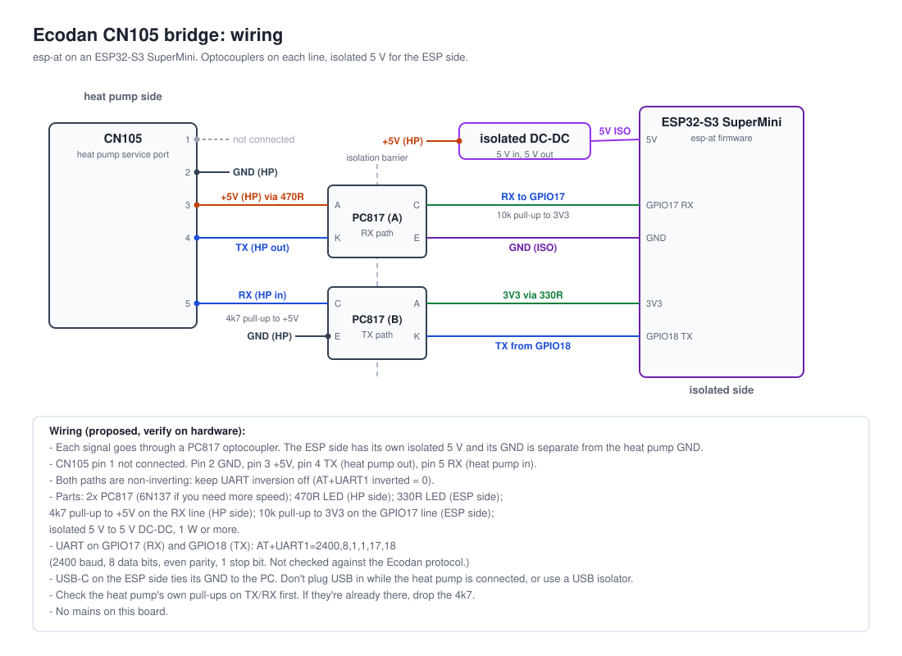

# Ecodan ESP32 bridge

An ESP32-S3 SuperMini that plugs into the CN105 service port of a Mitsubishi
Ecodan heat pump. The firmware is [esp-at](https://github.com/aardbeiplantje/esp-at)
(a submodule in `esp-at/`), which gives AT commands over USB serial and BLE,
WiFi and a local TCP server. The CN105 code is in `esp-at/esp-at/plugins.cpp`,
using esp-at's plugin hooks.

## Status

- Firmware builds for `esp32s3` (`python3 deploy.py build ecodan`). Program
  storage use is about 34%.
- CN105 link: reads and checks frames and logs them. Read-only, except
  `AT+CN105_CONNECT`, which sends the connect request by hand. Frame format and
  checksum come from public CN105 references and haven't been checked against an
  Ecodan yet.
- Not done yet: the Ecodan logic (what the frames mean), exposing the link over
  BLE or TCP, and any Modbus interface.
- The wiring is a proposal and hasn't been checked on a heat pump.

## Wiring



The schematic is generated from `docs/gen_schematics.py`. Don't edit the SVG
by hand.

| CN105 pin | Signal               | Goes through                     | Board side                     |
|-----------|----------------------|----------------------------------|--------------------------------|
| 1         | not connected        | -                                | leave open                     |
| 2         | GND (heat pump)      | opto B emitter, opto A LED       | heat pump GND, not the ESP GND |
| 3         | +5 V (heat pump)     | 470R into opto A LED, 4k7 pull-up on pin 5, DC-DC input | heat pump side only |
| 4         | TX (heat pump out)   | opto A LED                       | GPIO17 (RX) via opto A output  |
| 5         | RX (heat pump in)    | opto B output                    | GPIO18 (TX) via opto B LED     |

- Each signal line goes through a PC817 optocoupler. The ESP side has its own
  isolated 5 V from a DC-DC converter, and its GND is separate from the heat
  pump GND.
- Both paths are non-inverting. The firmware UART isn't inverted.
- Parts: 2x PC817 (6N137 if you need more speed), 470R (opto A LED, heat pump
  side), 330R (opto B LED, ESP side), 4k7 pull-up to +5 V on the RX line (heat
  pump side), 10k pull-up to 3V3 on the GPIO17 line (ESP side), isolated 5 V
  to 5 V DC-DC converter (1 W or more).
- Check the heat pump's own pull-ups on TX and RX first. If they're already
  there, drop the 4k7.
- USB-C on the ESP side ties its GND to the PC. Don't plug USB in while the
  heat pump is connected, or use a USB isolator.
- There's no mains on this board. Don't tie the heat pump's GND to mains earth.

### Serial settings

The CN105 link is fixed in `plugins.cpp`, not set with AT commands: 2400
baud, 8 data bits, even parity, 1 stop bit, on Serial2 with RX on GPIO17 and TX
on GPIO18. The 2400 8E1 setting comes from other CN105 projects and hasn't been
checked against the Ecodan protocol. esp-at's UART1 isn't used for CN105, since
its bridge treats bytes as text.

## First-time setup

1. Flash the board over USB (`python3 deploy.py deploy ecodan --monitor`), or
   flash only with `python3 deploy.py flash ecodan`.
2. Open the USB serial console (`python3 deploy.py monitor ecodan`) and send
   AT commands. Each one ends with CR LF.
   BLE stays off until a PIN is set, so this step has to be done over USB.
3. Set the BLE PIN and security, then the WiFi and the UART:

   ```
   AT+BLE_PIN=<6 digits>     # 000000 is refused
   AT+BLE_SECURITY=1         # 1 = PIN, 2 = bonding. 0 (no security) is refused
   AT+WIFI_SSID=<ssid>
   AT+WIFI_PASS=<password>
   AT+WIFI_ENABLED=1
   AT+RESET
   ```

4. Check the state with `AT+IP_STATUS?`, `AT+WIFI_STATUS?` and `AT+BLE_STATUS?`.
   On the CN105 link, `AT+CN105_STATUS?` shows the frame counts. The serial
   log shows each frame (`[CN105] RX ...`).

The full AT command list is in the esp-at README:
[esp-at/README.md](esp-at/README.md) (or send `AT+?` or `AT+HELP?` to the board).

## Access

- **BLE:** the Nordic UART Service, for esp-at's AT commands. Pair with the PIN.
  The [`ble_uart.pl`](esp-at/ble_uart.pl) client in esp-at connects to it.
- **TCP:** the esp-at TCP server accepts only clients on the local network
  (loopback, RFC1918, link-local, IPv6 ULA). Don't forward the port on the
  router. The CN105 link isn't on it yet.
- Config (PIN, security, WiFi, UART) is only set on the device. It's never
  stored in this repo.

## Build

Prerequisites: `arduino-cli`, Python 3.11 or newer, and `pyserial`.

```sh
git clone --recurse-submodules git@github.com:CowboyTim/mel-esp32.git
cd mel-esp32
python3 deploy.py update          # ESP32 core 3.3.12 and SerialCommands
python3 deploy.py build ecodan
```

If you cloned without `--recurse-submodules`, run `git submodule update --init`.

`boards.toml` lists the physical boards by MAC address. Plug a board in and
run `python3 deploy.py list` to see which ones are connected.

Builds write to `dist/` and `.build/` in this repo. The submodule is only read.

## Repository layout

- `esp-at/`: submodule, [aardbeiplantje/esp-at](https://github.com/aardbeiplantje/esp-at).
  The pinned commit is on its `main` branch. It has the BLE PIN and local-only
  TCP changes, and is used as the firmware framework. The CN105 code is in
  `esp-at/esp-at/plugins.cpp`.
- `deploy.py`: build, flash and monitor tool.
- `boards.toml`: physical boards.
- `docs/`: schematic and its generator.
- `AGENTS.md`: guidance for coding agents.

## Open items

- Confirm the CN105 pinout, serial settings and frame format on the actual Ecodan.
- Work out what the frames mean (the Ecodan protocol) and decide on the
  read-only set of values before any write is allowed.
- Decide whether a Modbus interface is needed. The CN105 protocol isn't
  Modbus, so Modbus would need an adapter or a bridge on top of this board.

## License

Unlicense. See [LICENSE](LICENSE). esp-at is also public domain.
